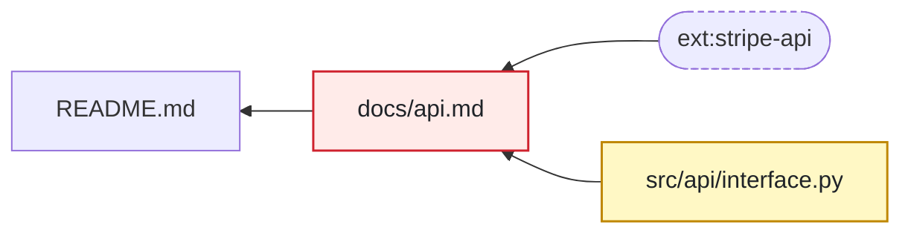

# freshdags 🦡✨

A small CLI that helps prevent documentation drift — especially in codebases where agents change code faster than anyone re-reads the docs. It works just as well for keeping any file consistent with the specs and invariants it depends on.

> **Status:** early (0.2). All commands below work; the file format may still change, and newer versions upgrade older files.

## Install

From [PyPI](https://pypi.org/project/freshdags/):

```sh
uv tool install freshdags   # or: pipx install freshdags
```

To try it without installing: `uvx freshdags --help`.

## Quick start

Tell freshdags which docs depend on which files. They must be tracked by git; `git add` new files first:

```sh
freshdags add docs/api.md src/api/interface.py
freshdags add README.md docs/api.md
```

This creates `freshdags.json` in the repository root. Commit it with your code.

Later, someone changes `src/api/interface.py` and commits. Now:

```sh
$ freshdags check
docs/api.md may have drifted
  src/api/interface.py changed since 3f2a91c
    review: git diff 3f2a91c..HEAD -- src/api/interface.py
  then: update docs/api.md where the change made it wrong,
  or, only if it is still correct: freshdags resolve docs/api.md --note "why"

🦡 1 doc may have drifted. The badger is watching.
Never resolve just to make this check, a hook or CI pass.
```

What to do next depends on whether the doc still holds:

## Everyday use

**A source changed and the doc is out of date.** Update the doc and commit it; that clears the flag. Because the doc changed, the docs that depend on it (here `README.md`) are flagged next, and you handle them the same way until:

```sh
$ freshdags check
🦡✨ All 2 docs are fresh.
```

**A source changed, but the doc is still correct.** Resolve it, saying why. The note is required: a resolve claims that the doc still holds, and the note makes that claim reviewable in `freshdags.json`. The doc did not change, so its dependents stay fresh.

```sh
freshdags resolve docs/api.md --note "internal refactor, API unchanged"
freshdags resolve --all --note "formatting only"    # every drifted doc at once
```

Never resolve just to make a check, a hook or CI pass.

**Something changed that git cannot see** — a vendor API, or a behaviour change that did not touch the file a doc depends on:

```sh
freshdags flag ext:stripe-api --note "API v2 released"
freshdags flag src/api/interface.py --note "timeouts now in seconds"
```

## Integration

**Stop drift before it is committed** with [pre-commit](https://pre-commit.com). Add to `.pre-commit-config.yaml`:

```yaml
repos:
  - repo: https://github.com/mkcode92/freshdags
    rev: v0.2.0
    hooks:
      - id: freshdags
```

The hook runs `freshdags check --uncommitted`: the changes you are committing count as a commit made now, so a source change without its doc update fails the commit, as does older drift that is still open. If the doc needs no update, resolve it and commit again: the resolve records the content you reviewed, so committing exactly that content keeps the doc fresh.

**Check a pull request in CI**, for drift that was committed anyway. `check` exits with `1` when something drifted. It needs the git history, so fetch it fully:

```yaml
- uses: actions/checkout@v4
  with:
    fetch-depth: 0
- uses: astral-sh/setup-uv@v6
- run: uvx freshdags check
```

**Work with agents.** With the pre-commit hook, an agent sees the `check` report whenever it commits drift, including what to do about it. Run `freshdags configure --auto-flag on-change --auto-resolve on-change` (see [Settings](#settings)) so drift shows up as soon as a file is saved; agents can also read `freshdags check --json`. Add the rules the report cannot enforce to your `AGENTS.md` (Claude Code reads it through a `CLAUDE.md` containing `@AGENTS.md`):

```markdown
## Keeping docs fresh

`freshdags.json` records which docs describe which files (https://github.com/mkcode92/freshdags).

- When `freshdags check` or the pre-commit hook reports drift, update each doc where the
  change made it wrong. Run commands to see their output; do not guess it.
- Resolve only a doc that is still correct: `freshdags resolve DOC --note "why"`.
  Never resolve just to make a check, hook or CI pass.
- When a doc starts describing another file: `freshdags add DOC SOURCE`.
- Never edit `freshdags.json` by hand or commit with `--no-verify`.
```

## Viewing the graph

```sh
freshdags show                        # every doc with its sources
freshdags show src/api/interface.py   # one node's sources and dependents
```

`(!)` marks a doc that may have drifted, `(*)` a source that changed after the doc it is listed under was up to date:

```text
README.md
  docs/api.md (!)
docs/api.md (!)
  ext:stripe-api
  src/api/interface.py (*)

(!) may have drifted   (*) changed after the doc it is listed for
```

To draw it, write it to a file; the extension picks the format (or use `--format`):

```sh
freshdags show -o graph.md     # Mermaid in a Markdown block, drawn by GitHub and GitLab
freshdags show -o graph.html   # a standalone page with details on hover
freshdags show -o graph.dot    # Graphviz DOT (`.mmd` gives plain Mermaid)
```

The same graph as `graph.md`: drifted docs are red, the sources that made them drift amber, external nodes dashed.



The HTML page loads Mermaid from a CDN, but the graph never leaves your machine: the page may load nothing else and send nothing.

## What to track

**Point docs at interfaces, not implementations.** If a doc depends on implementation details, every refactor flags it and the signal turns into noise. Keep APIs and interfaces in their own files and make docs depend on those.

**Not only docs.** "Doc" and "source" are just roles. Any file can depend on any other, in any direction, as long as there are no cycles. That makes freshdags useful for invariant-based coding too, wherever one file must stay consistent with another:

- an implementation depends on the spec or invariant it must satisfy;
- a client depends on the server's API schema;
- tests depend on the interface they pin down;
- a migration or config depends on the model it mirrors.

**Things outside the repository** are written as `ext:<name>`. They are the only nodes without a tracked file:

- **External doc**, e.g. a wiki page that describes repo code: a code change flags it. After updating the page, run `freshdags resolve ext:wiki-api --note "updated the wiki"`. Resolve it once right after adding it, since it has no commits.
- **External source**, e.g. a vendor API: freshdags cannot see it change, so run `freshdags flag ext:stripe-api` when it does.

## Commands

| Command | Purpose |
|---|---|
| `freshdags add DOC SOURCE...` | Record that DOC depends on each SOURCE. Creates `freshdags.json` if needed. Refuses missing or untracked files, self-dependencies and cycles. |
| `freshdags rm DOC SOURCE...` | Remove those dependencies, and nodes no longer connected to anything. |
| `freshdags show [NODE] [--format FORMAT] [-o FILE]` | Print the graph, or one node's sources and dependents, with drift marked `(!)` and `(*)`. The formats `mermaid`, `markdown`, `dot` and `html` draw the whole graph with drift highlighted. |
| `freshdags check [REV] [--json] [--uncommitted]` | List every doc that may have drifted. Without `REV`, uses the current `freshdags.json`, the history up to `HEAD` and, in `on-change` mode, uncommitted changes; with `REV`, evaluates the graph as of that commit. `--uncommitted` counts uncommitted changes as a commit made now, for pre-commit hooks. |
| `freshdags resolve DOC... --note TEXT` | Record that you read the docs and they are still correct, and why. Records the content of their sources as reviewed. |
| `freshdags resolve --all --note TEXT` | Resolve every drifted doc, when the change needed no doc update. |
| `freshdags flag NODE [--note TEXT]` | Record that a source changed, flagging the docs that depend on it. |
| `freshdags configure [--auto-flag MODE] [--auto-resolve MODE]` | Show the settings, or change them. |

**Exit codes:** `0` no drift, `1` drift found, `2` usage or graph-file error.

**Verbosity:** by default, commands print only their results (the `check` report, `show`) and errors. The options go before the command, as in `freshdags -q check`. `-v` adds confirmations such as "docs/api.md depends on src/api.py"; `-vv` adds diagnostics like the git commands run. `-q` prints nothing but errors, for hooks and CI that only need the exit code. Confirmations and diagnostics go to stderr, so `--json` output stays clean.

## Settings

Settings live in `freshdags.json`. Show them with `freshdags configure`, change them with e.g. `freshdags configure --auto-flag on-change --auto-resolve on-change`. They decide what happens automatically; the `flag` and `resolve` commands work in every mode.

| Setting | `on-commit` (default) | `on-change` | `off` |
|---|---|---|---|
| `auto-flag` | A commit to a source flags its dependents. | Also an uncommitted save. | Only `freshdags flag` marks a source as changed. |
| `auto-resolve` | A commit to a doc resolves it. | Also an uncommitted save. | Only `freshdags resolve` resolves a doc. |

- **`on-change`** suits agents, which see drift before they commit. Uncommitted changes are timed by the file's modification time; files whose content matches `HEAD` are ignored. `check REV` always uses committed history only.
- **`auto-resolve: on-commit` / `on-change`** means updating a doc resolves it, with no extra step. The trade-off: any edit, even a typo fix, clears the flag. The edit shows up in review next to the source change.
- **`auto-resolve: off`** makes every resolve an explicit, recorded decision.

## How it works

freshdags keeps your dependencies as a graph (a DAG) in `freshdags.json`. The rule is: **a doc must be at least as new as each of its sources.** If a source changed after the doc was last up to date, the doc is flagged until someone resolves it.

- **Times come from git:** a file's change time is the **author date** of the last commit that touched it. Author dates survive rebases, so rewriting a branch does not raise false flags. Because commits are the source of truth, a doc can be updated in a later commit of the same pull request.
- **A doc is up to date** from the commit that created it, from its last commit or save (as `auto-resolve` allows), or from its last `resolve` — whichever is latest. The `git diff` hint in `check` starts at that commit.
- **A resolve covers the content you reviewed.** It records the git blob hash of each source as it is in your working tree. A change to exactly that content needs no new review, even though committing it later makes it newer than the resolve. Any other change, and any `flag`, needs one.
- **Changes ripple, resolves do not.** A real change to a doc flags the docs that depend on it. Resolving a doc only states that it is still correct, so its dependents stay as they are.

### The graph file

`freshdags.json` is written by the tool; you should not need to edit it by hand. Keys are sorted so diffs stay small. A source appears only in `depends_on` lists, unless it carries a `flagged` record. Only the latest `resolved` and `flagged` record per node is kept; git holds the history.

```json
{
  "nodes": {
    "docs/api.md": {
      "depends_on": ["ext:stripe-api", "src/api/interface.py"],
      "resolved": {
        "at": "2026-11-19T10:00:00Z", "by": "Jane Doe", "commit": "3f2a91c...",
        "note": "internal refactor, API unchanged",
        "sources": { "src/api/interface.py": "8ab686e..." }
      }
    },
    "ext:stripe-api": {
      "flagged": { "at": "2026-11-01T00:00:00Z", "by": "Jane Doe", "note": "API v2 released" }
    }
  },
  "settings": { "auto-flag": "on-commit", "auto-resolve": "on-commit" },
  "version": 2
}
```

A resolve keeps its `note`, and in `sources` the reviewed content of each source file as a git blob hash; external sources have none. Review both in pull requests: a resolve is a claim that the doc is still correct.

**Format versions.** `version` changes whenever an older freshdags could not read the file. A newer freshdags reads older files and upgrades them; the next command that writes the file saves the new format, which shows up as a normal diff. An older freshdags refuses a newer file and asks you to upgrade. Version 2 (freshdags 0.2) added `sources` to resolves; resolves from version-1 files have none, so they cover changes by time only.

## Known limitations

- `resolve` and `flag` record the current wall-clock time, while commits carry the author's machine time. Clock skew between machines can misorder events that happen within minutes of each other.
- In `on-change` mode, file modification times are compared with commit author dates, with the same caveat.

## Planned

- `--base REV` for `check`, to report only drift introduced by a pull request
- Directory and glob sources, so a per-directory README tracks new files automatically

## Development

Requires [uv](https://docs.astral.sh/uv/).

```sh
uv sync
uv run pre-commit install   # freshdags checks its own docs before each commit
uv run freshdags --help
uv run pytest
uv run ruff check . && uv run ruff format --check .
```

**Releasing:** bump `version` in `pyproject.toml`, commit, and push a tag like `v0.1.0`. The publish workflow checks that the tag matches the version, builds, and uploads to PyPI.

## License

[MIT](LICENSE)
